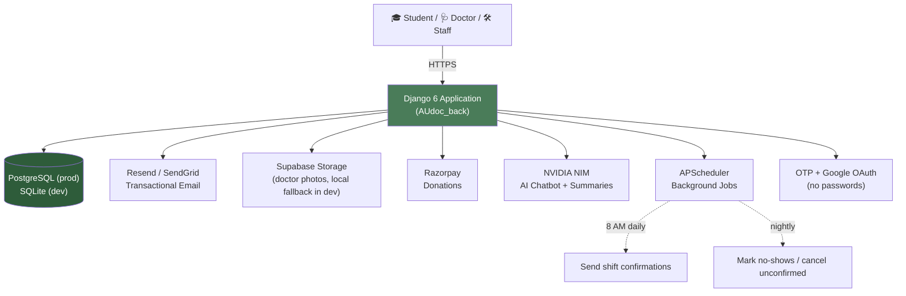
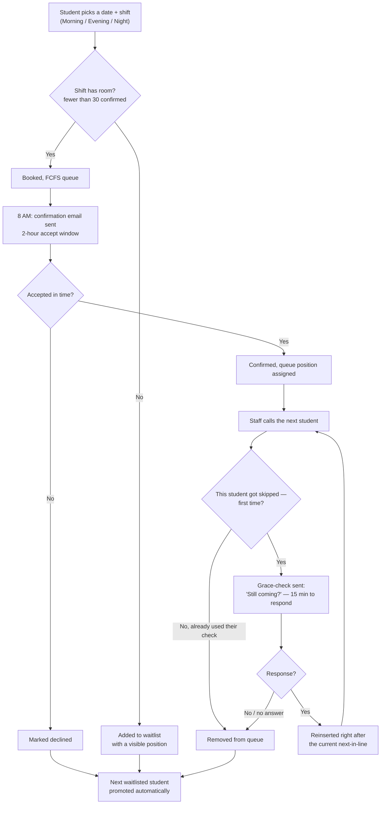
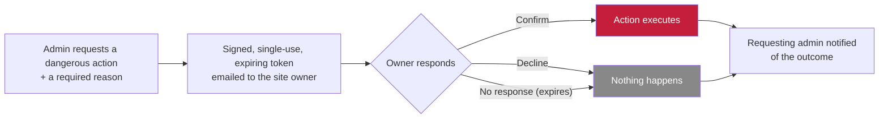
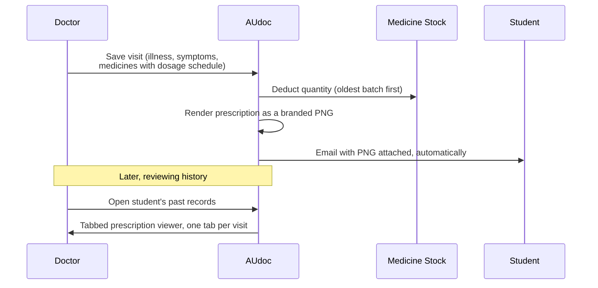

<div align="center">


# 🏥 AUdoc — Campus Health, Minus the Queue

**A full campus health platform for Assam University Silchar — appointments, shifts, blood bank, digital prescriptions, and an admin panel that can shut the whole thing down in an emergency (with your permission first).**

[](https://www.djangoproject.com/)
[](https://www.python.org/)
[](LICENSE)
[]()
[]()

Visit: <https://voiddoc.me>

</div>

---

## 📖 What Is This

AUdoc is the health center management system for AUS — one Django app covering the whole loop: a student books a shift-based appointment, a doctor sees them and writes a digital prescription, the student gets it emailed to them as a downloadable PNG, the medicine stock quietly deducts itself, and if a student doesn't show up, the system politely asks them once before giving their spot to someone else. There's also a blood bank, a donation flow, an AI chatbot, and an admin panel with its own "break glass in case of emergency" shutdown switch — one that texts the site owner for permission before it actually breaks anything.

It started as a weekend project to stop losing track of who's waiting in line at Block C. It did not stay small.

---

## 📋 Table of Contents

- [Features](#-features)
- [System Architecture](#-system-architecture)
- [Key Workflows](#-key-workflows)
- [Tech Stack](#-tech-stack)
- [Project Structure](#-project-structure)
- [Data Model Overview](#-data-model-overview)
- [Getting Started](#-getting-started)
- [Scheduled Tasks](#-scheduled-tasks)
- [Security](#-security-because-were-not-monsters)
- [Design Language](#-design-language-for-contributors-who-care-about-pixels)
- [Roadmap](#-roadmap)
- [Contributing](#-contributing-help-voidnova-stay-awake)
- [License](#-license)

---

## ✨ Features

### 🎓 For Students

| Feature | Description | Why You'll Love It |
| --------- | ------------- | ------------------- |
| 🔐 **Passwordless Login** | OTP via email, or Google sign-in | No "forgot password" at 2 AM |
| 📅 **Shift-Based Booking** | Pick a date + Morning / Evening / Night shift, not a vague "sometime today" | You know roughly when you'll be seen |
| 🎫 **Live Queue Position** | See exactly where you stand, with an estimated time | No more "is it my turn yet?" texts to the front desk |
| 📝 **Waitlist, Not Rejection** | Shift full? You get a numbered waitlist spot, not a dead end | Cancellations and no-shows can still reach you |
| 💊 **Digital Prescriptions** | Full dosage, timing, food instructions — not just a medicine name | Know exactly when to take what |
| 📧 **Prescription by Email** | A branded PNG, attached automatically the moment the doctor saves your visit | Show it at any pharmacy, no app needed |
| 🩸 **Blood Bank Access** | Register as a donor or request blood, with urgency levels | Find or give blood without a dozen phone calls |
| 💬 **AI Health Assistant** | Chatbot for quick, non-emergency questions | 3 AM "is this normal" questions, answered |
| 💳 **Donations** | Support the health center directly via Razorpay | Put your money where your gratitude is |

### 🩺 For Doctors

| Feature | Description | Why You'll Love It |
| --------- | ------------- | ------------------- |
| 🗂️ **Tabbed History Viewer** | Open multiple past prescriptions side-by-side, VS-Code style | Compare visits without losing your place |
| 🧠 **AI Summarization** | Quick summary of a student's medical history | Skip the skimming |
| 📆 **Shift Grid** | Set your own Morning / Evening / Night availability per weekday | No more "wait, am I even working Tuesday?" |
| 🏖️ **Leave Management** | Mark yourself unavailable, system handles the rest | Take a day off without a group chat |

### 🛠️ For Admins & Staff

| Feature | Description | Why You'll Love It |
| --------- | ------------- | ------------------- |
| 🎨 **Modern Admin Panel** | Glass-morphism UI with dark/light mode, at `/manage/` | Your eyes won't melt at 3 AM |
| 💊 **Prescription Builder** | Search-as-you-type medicine picker, quick-add chips, auto-calculated quantities | A full prescription in under 30 seconds |
| 📦 **Pack-Aware Stock** | Receive stock as "5 packs of 10" instead of doing the math yourself | No more miscounted strips |
| 🩸 **Blood Bank Admin** | Donor registrations with urgency levels, token-based accept/decline | URGENT = I really need this |
| 👨‍⚕️ **Doctor & Staff Management** | Specialties, shift grids, leaves, all in one place | Control the chaos |
| 📊 **Live Dashboard** | Stats, charts, system health, in real time | Look important in meetings |
| 📤 **Data Export** | CSV/Excel for registrations, donors, everything | Flex on spreadsheet people |
| 🔍 **Smart Search** | Instant search across students, donors, medicines | Find anything in seconds |

### 🚨 Danger Zone — Owner-Approved Emergency Controls

This is the part most student projects don't have, and it exists because deleting a semester's worth of appointment history or taking the whole site offline shouldn't be one click for one person.

| Feature | Description | Why It Matters |
| --------- | ------------- | ------------------- |
| 🛑 **Emergency Shutdown** | Admin requests → site owner gets an email with the reason → confirm or decline | No single admin can take the site down alone |
| 🔓 **Three Ways Back Online** | Normal login (staff are never locked out), a no-login restore link in the email, or automatic restore after a set number of hours | A lost phone can't leave the site down forever |
| 🗑️ **Approved Data Deletion** | Both "wipe everything" and "delete just this category" require the owner's email approval first | Nobody accidentally (or maliciously) nukes a semester of records |
| 📨 **Decision Loop-Back** | Whoever requested the action gets notified whether it was approved or declined | No more wondering if anyone saw the request |

---

## 🏗️ System Architecture



---

## 🔄 Key Workflows

### 1. Shift Booking → Waitlist → No-Show Recovery

The core loop of the whole app. A shift has a 30-person cap; once it's full, new requests become a waitlist instead of a rejection, and the system actively tries to recover wasted slots rather than just letting them sit empty.



### 2. Danger Zone — Owner-Approval Gate

Both the emergency shutdown and data-deletion controls share this exact pattern: nothing destructive or site-wide happens without an out-of-band "yes" from the site owner.



*For shutdown specifically: once confirmed, every non-staff session is logged out and the site blocks all non-staff traffic. Getting back online never needs a second approval — any staff login works immediately, plus a no-login restore link and an automatic restore timer exist as backups.*

### 3. Digital Prescription, Start to Finish



---

## 🛠️ Tech Stack

```
┌──────────────────┬──────────────────────────────────────────────┐
│  Backend         │  Django 6.0.3  ·  Python 3.12                │
│  API Framework   │  Django REST Framework 3.16.1                │
│  Database        │  PostgreSQL (Render)  ·  SQLite (dev)        │
│  File Storage    │  Supabase Storage  ·  local fallback (dev)   │
│  Caching         │  Redis (django-redis)  ·  in-memory fallback │
│  Authentication  │  OTP-based + Google OAuth (no passwords!)    │
│  Email           │  Resend / SendGrid  ·  TLS                   │
│  Image Generation│  Pillow (digital prescriptions, rendered     │
│                  │  server-side, never a client-side screenshot)│
│  Payments        │  Razorpay                                    │
│  AI Chatbot      │  NVIDIA NIM (OpenAI-compatible LLM endpoint) │
│  Background Jobs │  APScheduler                                 │
│  Admin Panel     │  Custom UI at /manage/ (not /admin/)         │
│  Static Serving  │  WhiteNoise                                  │
│  Hosting         │  Render                                      │
└──────────────────┴──────────────────────────────────────────────┘
```

---

## 🗂️ Project Structure

```
AUdoc/
│
├── 📂 AUdoc_back/                       # Django backend
│   ├── 📂 AUdoc_back/                   # Project configuration
│   │   ├── settings.py                  # App settings (secrets via .env)
│   │   ├── urls.py                      # Root URL router + custom 404/500 handlers
│   │   └── wsgi.py / asgi.py            # Deployment entry points
│   │
│   ├── 📂 app/                          # The main application
│   │   ├── models.py                    # 22 models — see Data Model Overview
│   │   ├── views.py                     # Views, AJAX endpoints, business logic
│   │   ├── forms.py                     # Django forms
│   │   ├── admin.py                     # Admin customization + auto-provisioning
│   │   ├── security.py                  # Rate limiting, OTP, security event logging
│   │   ├── backends.py                  # Custom OTP authentication backend
│   │   ├── middleware.py                # Site-wide maintenance / shutdown gate
│   │   ├── doctor_availability.py       # Shift + slot availability logic
│   │   ├── prescription_render.py       # PNG prescription generator (email attachment)
│   │   ├── prescription_renderer.py     # PNG generator for the doctor-side viewer
│   │   ├── resend_backend.py            # Custom Resend email backend
│   │   ├── sendgrid_backend.py          # Custom SendGrid email backend
│   │   ├── signals.py                   # Login audit signal handler
│   │   ├── storage.py                   # Supabase Storage uploads (local fallback)
│   │   ├── urls.py                      # App URL routes
│   │   ├── 📂 static/fonts/             # Bundled fonts for prescription rendering
│   │   ├── 📂 templates/
│   │   │   ├── 404.html                 # "Department of Missing Pages" error page
│   │   │   └── 📂 app/                  # HTML templates
│   │   └── 📂 management/commands/
│   │       ├── send_appointment_confirmations.py
│   │       ├── cancel_unconfirmed_appointments.py
│   │       └── mark_shift_no_shows.py
│   │
│   ├── 📂 media/                        # Local fallback storage (dev only)
│   ├── SECURITY.md                      # Security documentation
│   ├── .env.example                     # Copy to .env and fill in your secrets
│   ├── requirements.txt                 # Python dependencies
│   └── manage.py                        # Django management CLI
│
├── render_build.sh / render_start.sh    # Render deployment scripts
├── .gitignore
└── README.md                            # You are here 📍
```

> **Note:** this repository is the Django backend only — there is no Flutter or other frontend client in this repo at this time.

---

## 🗄️ Data Model Overview

22 models, grouped by what they're actually for:

| Domain | Models |
| --- | --- |
| **People & Auth** | `StudentProfile`, `StaffProfile`, `Doctor`, `LoginLog`, `StaffPasswordResetToken` |
| **Appointments & Shifts** | `Appointment`, `TodaysAppointment`, `DoctorLeave`, `StudentNoShowRecord`, `StudentRegistration` |
| **Prescriptions** | `MedicalHistory`, `PrescribedMedicine` |
| **Medicine Inventory** | `Medicine`, `MedicineStock`, `MedicineStockTransaction` |
| **Blood Bank** | `BloodDonation`, `BloodRequest`, `DonorResponse` |
| **Donations & Support** | `Donation`, `HelpDesk` |
| **AI** | `AIChatLog` |
| **Site Governance** | `SiteMaintenance` |

**A note on `PrescribedMedicine`:** this is where the dosage system actually lives — each prescribed medicine carries its own dosage text, which times of day it's taken (morning / afternoon / evening / night, independently togglable), food timing, duration, route, and special instructions. It's not just "medicine + quantity" — it's a real prescription line.

---

## 🚀 Getting Started

```bash
# 1. Clone and enter the backend
git clone <this-repo-url>
cd AUdoc/AUdoc_back

# 2. Create and activate a virtual environment
python -m venv venv
source venv/bin/activate        # Windows: venv\Scripts\activate

# 3. Install dependencies
pip install -r requirements.txt

# 4. Configure environment
cp .env.example .env
# Fill in: DJANGO_SECRET_KEY, email provider keys, OWNER_APPROVAL_EMAIL, etc.

# 5. Migrate and create an admin account
python manage.py migrate
python manage.py createsuperuser

# 6. Run it
python manage.py runserver
```

Visit `http://127.0.0.1:8000/` for the student-facing site, `/manage/` for the admin panel.

---

## ⏰ Scheduled Tasks

Three background jobs keep the shift/queue system honest. In production these run via APScheduler automatically; for manual/cron setups:

| Command | When | What It Does |
| --- | --- | --- |
| `send_appointment_confirmations` | 8:00 AM daily | Emails today's queued students, opens the 2-hour accept window |
| `cancel_unconfirmed_appointments` | After the accept window closes | Declines anyone who didn't respond, frees their slot |
| `mark_shift_no_shows` | Nightly | Marks unvisited confirmed appointments as no-shows, logs the strike |

```bash
# Linux/macOS cron example
0 8 * * * cd /path/to/AUdoc_back && python manage.py send_appointment_confirmations
0 23 * * * cd /path/to/AUdoc_back && python manage.py mark_shift_no_shows
```

---

## 🔒 Security *(Because We're Not Monsters)*

| Feature | Protection Against |
| --------- | ------------------- |
| 🛡️ **Rate Limiting** | Brute force attacks on login/OTP |
| 🔐 **Secure OTP** | Cryptographically secure generation, constant-time comparison |
| 🚫 **SQL Injection** | Parameterized queries via Django ORM |
| 🔄 **CSRF Protection** | All state-changing operations require tokens |
| 🍪 **Secure Cookies** | HttpOnly, SameSite, Secure flags |
| 🔑 **Argon2 Hashing** | Memory-hard password hashing for staff accounts |
| 🌐 **OAuth Validation** | Strict checking of Google OAuth logins |
| 📝 **Security Event Logging** | Failed logins, rate-limit hits, and every Danger Zone action |
| 🛑 **Owner-Approval Gate** | Site shutdown and data deletion both require out-of-band email confirmation — see [Key Workflows](#-key-workflows) |

### Production Checklist

```env
DJANGO_SECRET_KEY=<generate a real one>
DJANGO_DEBUG=False
DJANGO_ALLOWED_HOSTS=yourdomain.com
DJANGO_CSRF_TRUSTED_ORIGINS=https://yourdomain.com
DJANGO_SECURE_SSL_REDIRECT=True
OWNER_APPROVAL_EMAIL=<the one inbox that approves shutdowns and deletions>
MAINTENANCE_AUTO_RESTORE_HOURS=12
```

> 📄 Full security documentation: [`AUdoc_back/SECURITY.md`](AUdoc_back/SECURITY.md)

---

## 🎨 Design Language *(For Contributors Who Care About Pixels)*

| Swatch | Hex | Used For |
| :---: | :--- | :--- |
|  | `#4a7c59` **Primary** | Buttons, links, nav highlights |
|  | `#2e5c3a` **Primary Dark** | Gradients, topbar, hover states |
|  | `#e8f5ec` **Mint Accent** | Soft backgrounds, tags, badges |
|  | `#c41e3a` **Alert Red** | Blood bank, destructive actions |
|  | `#fef3c7` **Amber** | Warnings, lockdown states, pending actions |

Prescriptions are rendered with the Inter font family server-side via Pillow — if you touch `prescription_render.py` or `prescription_renderer.py`, keep the font files in `app/static/fonts/` in sync between them.

---

## 📋 Roadmap

- [x] OTP + Google OAuth login
- [x] Shift-based appointment booking (Morning / Evening / Night)
- [x] Waitlist with automatic promotion
- [x] Grace-check no-show recovery
- [x] Digital prescriptions with full dosage scheduling
- [x] Prescription delivery by email (PNG attachment)
- [x] Pack-aware medicine stock
- [x] Owner-approval gate for site shutdown
- [x] Owner-approval gate for data deletion (both full-wipe and selective)
- [x] Custom incident-report-style error pages
- [ ] Per-doctor shift-load visibility (catch an uneven rotation before it's a complaint)
- [ ] Coverage-gap warnings (flag a day/shift with nobody assigned)
- [ ] Student-facing on-demand prescription re-download page
- [ ] Edit capability for existing medicines (currently add-only)
- [ ] Overbooking based on historical no-show rates, once there's enough data to calibrate it safely

---

## 🤝 Contributing *(Help voidnova Stay Awake)*

```
1. Fork the repo
2. Create your branch:   git checkout -b feat/amazing-feature
3. Commit your changes:  git commit -m "Add some amazing feature"
4. Push to your branch:  git push origin feat/amazing-feature
5. Open a Pull Request
```

> Write a meaningful PR description. Don't commit your `.env` file. If you fix a bug, buy voidnova a coffee (UPI accepted).

---

## 📄 License

MIT License — do whatever you want with it. Just don't blame voidnova if something breaks.

Built for students at **Assam University Silchar (AUS)**.

---

<div align="center">

Made with ☕ caffeine, 💻 late nights, and the genuine hope that AUS students stay healthy.

*"May your OTPs arrive fast, your shifts never overbook, your doctors be understanding, and your blood type always be in stock."*

⭐ **Star this repo if AUdoc saved you a trip to the front desk!** ⭐

</div>